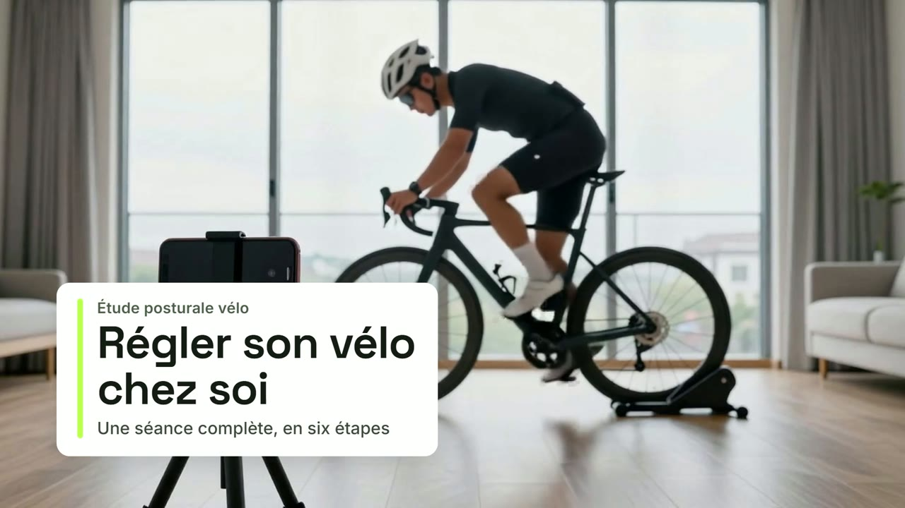

# Étude posturale vélo

Faire son étude posturale (bike fit) chez soi, sur son home trainer, avec un smartphone, quelques pastilles colorées
et, si on les a, les capteurs du vélo (puissance, équilibre gauche / droite, cardio).
Tout est traité sur le PC : aucune vidéo n'est envoyée en ligne. L'interface est en français.

<p align="center"></p>

> **Tutoriel vidéo (1 min 20)** : [frontend/public/tuto/seance.mp4](frontend/public/tuto/seance.mp4), aussi accessible
> depuis l'accueil de l'application. On y suit une séance complète : pastilles, téléphone, cadrage, prises, analyse, débrief.

**Principe** : le téléphone filme de profil pendant que tu pédales ; le PC suit les articulations (RTMW sur la carte
graphique, recalé sur les pastilles), mesure les angles sur des centaines de tours de pédale, les compare à des plages
sourcées, puis propose **une seule modification à la fois** (santé d'abord), que la séance suivante vient vérifier.
Les sorties Garmin importées confirment ensuite le réglage sur la route.

**Statut** : prototype personnel fonctionnel, validé sur vidéos synthétiques et données simulées ; la validation sur
des séances réelles est en cours ([état et validation](docs/05_etat_et_validation.md)). Ce n'est pas un avis médical :
en cas de douleur persistante, voir un professionnel.

## Documentation

- Cadrage et décisions : [PROMPT_PROJET_ETUDE_POSTURALE.md](PROMPT_PROJET_ETUDE_POSTURALE.md)
- Phase 0 : [état de l'art](docs/00_etat_de_l_art.md), [métriques](docs/01_metriques.md), [matériel](docs/02_materiel.md)
- Phase 1 : [spécification](docs/03_specification.md), [benchmark de pose](docs/04_benchmark_pose.md), [référentiel sourcé](config/metrics.yaml)
- Phases 2–5 : [état d'avancement et validation](docs/05_etat_et_validation.md)

## Ce que fait l'application

| Écran | Rôle |
|---|---|
| Mon profil, Mon vélo | Mensurations, géométrie, cotes et cales (schémas « où mesurer »), historique des configurations |
| Santé et ressentis | Carte des douleurs cliquable, 9 auto-tests guidés, questionnaire après chaque sortie |
| Séances de capture | Check-list, calibration ChArUco, dépôt des vidéos (profil, face, dos) et du .FIT, analyse automatique |
| Analyse | Verdict hauteur de selle + correction en mm, squelette superposé à la vidéo, courbe du genou, toutes les mesures sourcées |
| Recommandations | Hypothèses ordonnées comme chez un fitter (santé → charge → asymétrie → cales → selle → recul → manivelle) |
| Rapport | Synthèse imprimable / PDF, comparaison G/D et avant/après |
| Séance guidée | Le coach pilote la séance à la voix : pastilles, téléphone, home trainer en ERG, échauffement, prises chronométrées, import, débrief et une seule modification |
| Coach IA | Questions à l'écrit ou à la voix (appui pour parler ou mains libres), réponses lues à voix haute, images clés de l'analyse en option |
| Réglages IA et voix | Fournisseur (Ollama, LM Studio, OpenAI, Anthropic, Google, Mistral…), clés chiffrées par Windows, voix Piper / Whisper |
| Contrôle des pastilles | Sur une photo ou une image de la vidéo : pastilles trouvées, pipette, réglage des couleurs utilisé par les analyses |
| Cadrage en direct | MediaPipe dans le navigateur : feu vert seulement quand un cycliste entier est bien de profil ; l'image du téléphone (QR code) s'affiche en direct sur le PC |
| Capteurs et ERG | Web Bluetooth : puissance et équilibre (Assioma), cardio, puissance imposée au Tacx Neo 2T |
| Mes sorties | Import en lot de fichiers .FIT ou .zip Garmin Connect, comparaison avant / après réglage, détail d'une sortie (équilibre G/D au fil du temps, efficacité du couple, fluidité, phases de poussée) |
| Tutoriel | Vidéo d'une séance guidée, par chapitres, depuis l'accueil, le guide de démarrage et la séance guidée |

## Matériel

- **Obligatoire** : vélo sur home trainer, smartphone, trépied, pastilles (ou mire ChArUco), mètre ruban, un PC.
  Une carte NVIDIA accélère fortement l'analyse (développé sur RTX 4090).
- **Recul** : prévoir environ **2 m** entre le téléphone (zoom 1x, à l'horizontale, à hauteur de selle) et le vélo.
  Seuls le cycliste des épaules aux pieds et le pédalier doivent être dans l'image : la roue avant et la tête peuvent
  sortir du cadre. Éviter l'ultra grand-angle (0,5x) : la déformation fausse les angles.
- **Optionnel** : home trainer connecté (ERG), pédales capteur de puissance, cardio, micro, compteur GPS (.FIT), mire
  ChArUco imprimée ([calibration/](calibration/)), coach IA local ou en ligne.

## Installation

Prérequis : Python 3.10+, Node.js 20+, ffmpeg dans le PATH, pilote NVIDIA récent.

### En un clic (Windows)

Double-cliquer `scripts\installer.bat` (une fois), puis `scripts\lancer.bat` à chaque utilisation :
le backend et l'interface s'ouvrent dans deux fenêtres et le navigateur s'ouvre sur l'application.
Le script d'installation applique lui-même le correctif ONNX Runtime GPU décrit ci-dessous.

### À la main

#### Backend

```bash
cd backend && python -m venv .venv
```

```bash
backend/.venv/Scripts/python -m pip install -e "backend[dev,gpu]"
```

`rtmlib` tire la version CPU d'ONNX Runtime, qui masque la version GPU. Après l'installation :

```bash
backend/.venv/Scripts/python -m pip uninstall -y onnxruntime
```

```bash
backend/.venv/Scripts/python -m pip install --force-reinstall --no-deps onnxruntime-gpu==1.23.2 nvidia-cudnn-cu12==9.10.2.21
```

Vérification (doit afficher `GPU (CUDA)`) :

```bash
backend/.venv/Scripts/python -c "from posturale.pose.engines import available_engines; print(available_engines())"
```

Les modèles RTMW (~250 Mo) sont téléchargés depuis OpenMMLab à la première analyse.

#### Interface

```bash
npm --prefix frontend install
```

## Lancer

Backend, depuis la racine du dépôt :

```bash
backend/.venv/Scripts/python -m uvicorn posturale.api.main:app --port 8000 --app-dir backend/src
```

Interface :

```bash
npm --prefix frontend run dev
```

Ouvrir http://localhost:5180. Données dans `data/` (base SQLite, vidéos, résultats) — ignoré par git.

### Utiliser le téléphone (cadrage en direct, Bluetooth)

Le navigateur n'autorise la caméra et le Bluetooth qu'en HTTPS. Avec [mkcert](https://github.com/FiloSottile/mkcert) :

```bash
mkcert -install
```

```bash
cd frontend && mkdir -p certs && mkcert -cert-file certs/cert.pem -key-file certs/key.pem localhost 192.168.1.10
```

(remplacer `192.168.1.10` par l'adresse IP du PC), installer l'autorité `rootCA.pem` (dossier donné par `mkcert -CAROOT`) sur le téléphone, relancer l'interface, puis ouvrir `https://192.168.1.10:5180/cadrage` sur le téléphone.

## Coach IA et voix

- **Sur ce PC (par défaut)** : Ollama ou LM Studio. Rien ne sort. Exemple avec un modèle qui lit aussi les images :

```bash
ollama pull gemma4:12b
```

- **En ligne** : OpenAI, Anthropic, Google, Mistral (UE), OpenRouter, Groq, DeepSeek, OVHcloud (UE) ou tout service compatible OpenAI.
  La clé se saisit dans « Réglages IA et voix » ; elle est chiffrée par Windows (DPAPI) et n'est jamais renvoyée à l'interface.
- **Ce qui est envoyé** : un résumé texte (profil, vélo, mesures, douleurs, hypothèses du moteur), visible dans « Ce que voit le coach ».
  Jamais la vidéo. Les images clés (squelette dessiné, 1024 px) seulement si tu l'autorises dans les réglages et le demandes.
- **Voix** : en ligne avec ta clé (chiffrée) — Fish Audio (modèle gratuit s2.1-pro-free, usage personnel), Google Cloud (≈ 1 million de caractères gratuits par mois), Azure Speech (500 000 par mois, offre F0), Cartesia —, ou Piper sur le PC (les voix françaises de LMU Stats Viewer sont reprises automatiquement, sinon copier `piper.exe` et une voix
  `.onnx` + `.onnx.json` dans `data/voice/`), Whisper `large-v3-turbo` sur la carte (≈ 1,6 Go téléchargés au premier usage dans `models/`),
  ou OpenAI. Commandes comprises sans IA : « répète », « stop », « efface ».

## Premier lancement

Au premier lancement, un **guide de démarrage** (6 écrans, voix off) explique le fonctionnement et demande ton matériel :
**obligatoire** (vélo sur home trainer, smartphone, trépied, 2 pastilles orange ou mire ChArUco, mètre ruban),
**recommandé** (pastilles vertes, éclairage) ou **optionnel** (home trainer connecté, capteur de puissance, micro, compteur .FIT,
mire, cardio, coach IA). L'outil s'adapte à tes réponses : séance guidée sans ERG (résistance fixe), sans pastilles vertes,
sans micro (barre d'espace), cases .FIT et calibration masquées… Le guide et « Mon équipement » restent dans le menu.
Les voix off sont générées une fois avec Cartesia (`scripts/generer_audio_onboarding.py`, clé dans `CARTESIA_API_KEY`).

## Téléphones reliés (QR code)

Dans la séance guidée (étape « Installer le téléphone ») ou sur le détail d'une séance, un **QR code** relie chaque téléphone
à la séance (même Wi-Fi que le PC, aucun compte). Le téléphone reçoit sa vue (profil droit, gauche, face, dos ; modifiable).

- **Enregistrement lancé depuis le PC** : à « c'est parti », les téléphones filment exactement la durée de la prise, puis
  **envoient la vidéo tout seuls** et l'analyse démarre. La préparation n'est pas filmée, plus besoin de clap.
- Le navigateur du téléphone n'ouvre la caméra qu'en **HTTPS**. `scripts\installer.bat` s'en charge : il crée une autorité
  propre à ce PC (`data\https\`, sans outil externe) et un certificat pour ses adresses (`frontend\certs\`), puis demande
  à Windows d'y faire confiance (réponds Oui). `scripts\lancer.bat` renouvelle le certificat si l'adresse Wi-Fi change.
  À la main : `backend\.venv\Scripts\python scripts\https_local.py --installer-autorite`.
  Sur le téléphone : « Continuer » la première fois, ou installer l'autorité (lien sous le QR code).
  Sans HTTPS, le téléphone se relie quand même et peut envoyer une vidéo filmée avec l'appli Appareil photo.
- **Sur un serveur derrière un proxy** (Nginx Proxy Manager…) : rien de tout cela, le proxy fournit un vrai certificat.
- L'interface est servie sur le réseau local (`host: true`) : au premier lancement, Windows peut demander d'autoriser Node.js
  sur les réseaux privés.

## Séance guidée

Menu « Séance guidée » (ou bouton sur la page Séances). Le plan est construit à partir de tes données :
**première séance** (deux profils), **vérification** après un réglage (mêmes prises, même puissance, comparaison avant / après)
ou **suivi** ; vue de face ou de dos ajoutée si une douleur le justifie.

- « Adapter la séance » demande au coach IA d'ajuster le plan (prises, puissance, échauffement, conseils par étape) dans des
  limites fixées par l'application ; sans IA, le plan reste valable.
- Pendant la séance, active « Mains libres » : « c'est fait », « suivant », « précédent », « c'est parti », « pause », « reprends »,
  « répète », « stop » ; toute autre phrase est une question au coach, qui connaît l'étape en cours. Barre d'espace = action principale.
- Le home trainer (ERG) et les pédales se connectent en Bluetooth : puissance douce puis cible pendant l'échauffement,
  rappel de cadence pendant les prises.
- Débrief : résultats, comparaison avec la séance précédente, puis **une seule modification** choisie par le moteur
  (santé d'abord, hauteur de selle seulement si les deux côtés concordent) et expliquée par le coach. « J'ai fait le réglage »
  enregistre la nouvelle configuration : la séance suivante devient une vérification.
- La séance se reprend où tu l'as laissée (par exemple pour importer les vidéos plus tard).

## Mes sorties (Garmin Connect)

Menu « Mes sorties ». Dans Garmin Connect, ouvrir une activité → ⚙ → « Exporter l'original » (un .zip), ou demander
l'export complet du compte ; les liens sont sur la page. Glisser les fichiers .FIT / .zip (ou un dossier entier) :
les sorties vélo sont gardées (course à pied et doublons ignorés) et rattachées au réglage en place à leur date.

- **Avant / après** : puissance, cardio, watts par battement, équilibre gauche / droite, efficacité et fluidité par réglage.
- **Détail d'une sortie** : courbes toutes les 5 minutes et lecture automatique qui compare tes deux jambes entre elles
  (déséquilibre, jambe qui faiblit en fin de sortie, poussée qui commence plus tard d'un côté — utile pour les cales).
- Le coach IA et le débrief de la séance guidée s'en servent pour vérifier le réglage sur la route.

## Tutoriel vidéo

Le film est produit dans [media/tuto/](media/tuto/) (composition HyperFrames ; images
Z-Image et LTX-2 dans ComfyUI, captures de l'application avec Playwright, voix Cartesia). Les scripts sont dans
`media/tuto/tools/` ; le rendu final est copié dans `frontend/public/tuto/`.

## Tests

```bash
cd backend && .venv/Scripts/python -m pytest
```

74 tests : noyau cinématique sur cycliste simulé, chaîne vidéo complète sur vidéo synthétique avec pastilles (angles retrouvés à ~1°),
calibration ChArUco sur la vraie mire, vues de face et de dos, import .FIT et sorties Garmin (fichiers générés par `tests/fitgen.py`),
moteur de recommandations, API, réglage des couleurs de pastilles, coach IA (fournisseurs, clés, flux), voix et séance guidée
(plan, adaptation par l'IA, débrief, modification unique).

## Confidentialité

Les données (profil, santé, vidéos, sorties, base SQLite) restent dans `data/`, ignoré par git. Les clés d'API sont
chiffrées par Windows (DPAPI). Seul le coach IA en ligne, s'il est choisi, reçoit un résumé texte ; jamais la vidéo.
